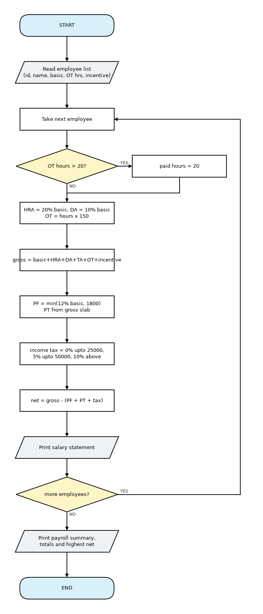
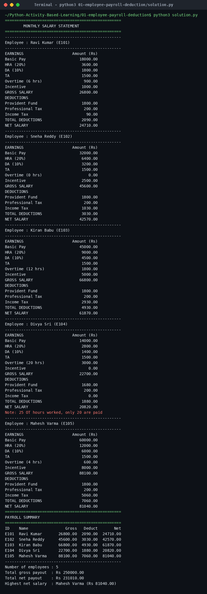

# Case Study 4 - Employee Payroll and Deduction Analysis

**Name:** AKKALA LAKSHMI VENKATA SAI  
**Roll No:** 26000414

## Problem statement

Calculate gross salary from basic pay, allowances, overtime, and incentives; apply progressive deductions and generate a formatted salary statement.

## Objectives

- Calculate HRA, DA, TA and overtime pay for every employee using arithmetic operators.
- Apply PF, professional tax and progressive income tax using conditional statements.
- Store employee details as tuples in a list and process them with a loop and tuple unpacking.
- Print a neat salary statement for each employee and a payroll summary at the end.

## Assumptions

- HRA is 20% of basic, DA is 10% of basic and TA is a fixed Rs 1500.
- Overtime is paid at Rs 150 per hour and at most 20 hours are paid in a month.
- PF is 12% of basic, but not more than Rs 1800.
- Professional tax: Rs 0 up to 15000 gross, Rs 150 up to 20000, Rs 200 above that.
- Income tax (monthly, on gross): 0% up to 25000, 5% on the part from 25000 to 50000, 10% on the part above 50000.
- Employee data is sample data, not real.

## Algorithm

```
1. START
2. Read the list of employees (id, name, basic, OT hours, incentive)
3. For each employee:
   3.1 If OT hours > 20 then paid hours = 20 else paid hours = OT hours
   3.2 HRA = 0.20 x basic, DA = 0.10 x basic, OT pay = paid hours x 150
   3.3 gross = basic + HRA + DA + TA + OT pay + incentive
   3.4 PF = 0.12 x basic; if PF > 1800 then PF = 1800
   3.5 PT = 0 if gross <= 15000, 150 if gross <= 20000, else 200
   3.6 tax = 0; for each slab add (part of gross inside the slab) x rate
   3.7 net = gross - (PF + PT + tax)
   3.8 Print the salary statement, add to totals, check for highest net
4. Print the summary table, totals and the highest net salary
5. STOP
```

## Flowchart



## Pseudocode

```
BEGIN PAYROLL
    FOR each (id, name, basic, ot, incentive) IN EMPLOYEES DO
        IF ot > 20 THEN ot_paid <- 20 ELSE ot_paid <- ot
        hra <- basic * 0.20
        da  <- basic * 0.10
        gross <- basic + hra + da + 1500 + ot_paid * 150 + incentive
        pf <- MIN(basic * 0.12, 1800)
        IF gross <= 15000 THEN pt <- 0
        ELSE IF gross <= 20000 THEN pt <- 150
        ELSE pt <- 200
        tax <- 0 ; lower <- 0
        FOR each (upper, rate) IN TAX_SLABS DO
            IF gross > lower THEN
                tax <- tax + (MIN(gross, upper) - lower) * rate
            lower <- upper
        END FOR
        net <- gross - (pf + pt + tax)
        PRINT statement
        total_gross <- total_gross + gross ; total_net <- total_net + net
        IF net > highest THEN highest <- net
    END FOR
    PRINT summary
END
```

## Python source code

File: [solution.py](solution.py)

```python
# Case Study 4 : Employee Payroll and Deduction Analysis
# Name    : AKKALA LAKSHMI VENKATA SAI
# Roll No : 26000414
#
# Gross salary = basic + HRA + DA + TA + overtime + incentive
# Deductions   = PF + professional tax + income tax (progressive)
# Net salary   = gross - deductions

# allowance rules
HRA_RATE = 0.20          # 20% of basic
DA_RATE = 0.10           # 10% of basic
TA_FIXED = 1500          # travel allowance (same for all)
OT_RATE = 150            # rupees per overtime hour
MAX_OT_HOURS = 20        # only 20 hours of overtime are paid in a month

# deduction rules
PF_RATE = 0.12           # 12% of basic
PF_LIMIT = 1800          # PF cannot be more than 1800

# income tax slabs on monthly gross (upper limit, rate)
TAX_SLABS = [(25000, 0.00), (50000, 0.05), (10 ** 9, 0.10)]

# (emp id, name, basic pay, overtime hours, incentive)
EMPLOYEES = [
    ("E101", "Ravi Kumar", 18000, 6, 1000),
    ("E102", "Sneha Reddy", 32000, 0, 2500),
    ("E103", "Kiran Babu", 45000, 12, 5000),
    ("E104", "Divya Sri", 14000, 25, 0),
    ("E105", "Mahesh Varma", 60000, 4, 8000),
]


def overtime_pay(hours):
    if hours < 0:
        hours = 0
    if hours > MAX_OT_HOURS:
        hours = MAX_OT_HOURS
    return hours * OT_RATE


def gross_salary(basic, ot_hours, incentive):
    hra = basic * HRA_RATE
    da = basic * DA_RATE
    ot = overtime_pay(ot_hours)
    gross = basic + hra + da + TA_FIXED + ot + incentive
    return hra, da, ot, gross


def provident_fund(basic):
    pf = basic * PF_RATE
    if pf > PF_LIMIT:
        pf = PF_LIMIT
    return pf


def professional_tax(gross):
    if gross <= 15000:
        return 0
    elif gross <= 20000:
        return 150
    else:
        return 200


def income_tax(gross):
    # progressive: each slab rate applies only to the part inside that slab
    tax = 0
    lower = 0
    for upper, rate in TAX_SLABS:
        if gross > lower:
            amount_in_slab = min(gross, upper) - lower
            tax = tax + amount_in_slab * rate
        lower = upper
    return tax


def net_salary(basic, ot_hours, incentive):
    hra, da, ot, gross = gross_salary(basic, ot_hours, incentive)
    pf = provident_fund(basic)
    pt = professional_tax(gross)
    it = income_tax(gross)
    total_ded = pf + pt + it
    return gross, total_ded, gross - total_ded


def print_statement(emp):
    emp_id, name, basic, ot_hours, incentive = emp
    hra, da, ot, gross = gross_salary(basic, ot_hours, incentive)
    pf = provident_fund(basic)
    pt = professional_tax(gross)
    it = income_tax(gross)
    total_ded = pf + pt + it
    net = gross - total_ded

    print("-" * 50)
    print(f"Employee : {name} ({emp_id})")
    print("-" * 50)
    print(f"{'EARNINGS':<25}{'Amount (Rs)':>15}")
    print(f"{'Basic Pay':<25}{basic:>15.2f}")
    print(f"{'HRA (20%)':<25}{hra:>15.2f}")
    print(f"{'DA (10%)':<25}{da:>15.2f}")
    print(f"{'TA':<25}{TA_FIXED:>15.2f}")
    paid_hours = ot_hours if ot_hours <= MAX_OT_HOURS else MAX_OT_HOURS
    print(f"{'Overtime (' + str(paid_hours) + ' hrs)':<25}{ot:>15.2f}")
    print(f"{'Incentive':<25}{incentive:>15.2f}")
    print(f"{'GROSS SALARY':<25}{gross:>15.2f}")
    print(f"{'DEDUCTIONS':<25}")
    print(f"{'Provident Fund':<25}{pf:>15.2f}")
    print(f"{'Professional Tax':<25}{pt:>15.2f}")
    print(f"{'Income Tax':<25}{it:>15.2f}")
    print(f"{'TOTAL DEDUCTIONS':<25}{total_ded:>15.2f}")
    print(f"{'NET SALARY':<25}{net:>15.2f}")
    if ot_hours > MAX_OT_HOURS:
        print(f"Note: {ot_hours} OT hours worked, only {MAX_OT_HOURS} are paid")
    return gross, total_ded, net


def main():
    print("=" * 50)
    print("        MONTHLY SALARY STATEMENT")
    print("=" * 50)

    total_gross = 0
    total_net = 0
    highest_name = ""
    highest_net = -1

    for emp in EMPLOYEES:
        gross, ded, net = print_statement(emp)
        total_gross = total_gross + gross
        total_net = total_net + net
        if net > highest_net:
            highest_net = net
            highest_name = emp[1]

    print("=" * 50)
    print("PAYROLL SUMMARY")
    print("=" * 50)
    print(f"{'ID':<6}{'Name':<15}{'Gross':>10}{'Deduct':>9}{'Net':>10}")
    for emp_id, name, basic, ot_hours, incentive in EMPLOYEES:
        gross, ded, net = net_salary(basic, ot_hours, incentive)
        print(f"{emp_id:<6}{name:<15}{gross:>10.2f}{ded:>9.2f}{net:>10.2f}")
    print("-" * 50)
    print(f"Number of employees : {len(EMPLOYEES)}")
    print(f"Total gross payout  : Rs {total_gross:.2f}")
    print(f"Total net payout    : Rs {total_net:.2f}")
    print(f"Highest net salary  : {highest_name} (Rs {highest_net:.2f})")


if __name__ == "__main__":
    main()
```

## Test cases

| TC | Input / what is checked | Expected | Result |
|----|-------------------------|----------|--------|
| 1 | overtime_pay(6) | 900 | Pass |
| 2 | overtime_pay(25) - only 20 hours paid | 3000 | Pass |
| 3 | overtime_pay(-2) | 0 | Pass |
| 4 | gross of E101 (18000, 6 hrs, 1000) | 26800 | Pass |
| 5 | PF for basic 14000 / basic 60000 | 1680 / 1800 (limit) | Pass |
| 6 | professional tax for 15000 / 18000 / 22700 | 0 / 150 / 200 | Pass |
| 7 | income tax on 22700 / 45600 / 66800 | 0 / 1030 / 2930 | Pass |
| 8 | net salary of E105 | 81040 | Pass |

The test cases are written in [test_cases.py](test_cases.py) (13 checks in total). Output of `python3 test_cases.py`:

```
PASS : overtime for 6 hours
PASS : overtime capped at 20 hours
PASS : negative overtime hours
PASS : gross of E101
PASS : PF for basic 14000
PASS : PF limited to 1800
PASS : PT for 15000
PASS : PT for 18000
PASS : PT for 22700
PASS : income tax on 22700
PASS : income tax on 45600
PASS : income tax on 66800
PASS : net salary of E105
----------------------------------------
Passed : 13  Failed : 0
```

## Output screenshot



Full text output: [output.txt](output.txt)

## Conclusion

The program calculates every part of the salary separately, so the statement clearly shows how the net salary is reached. The overtime limit (Divya Sri worked 25 hours but got paid for 20), the PF limit and all three income tax slabs show up in the output. Because the rates are kept as constants at the top, they can be changed easily without touching the logic.
