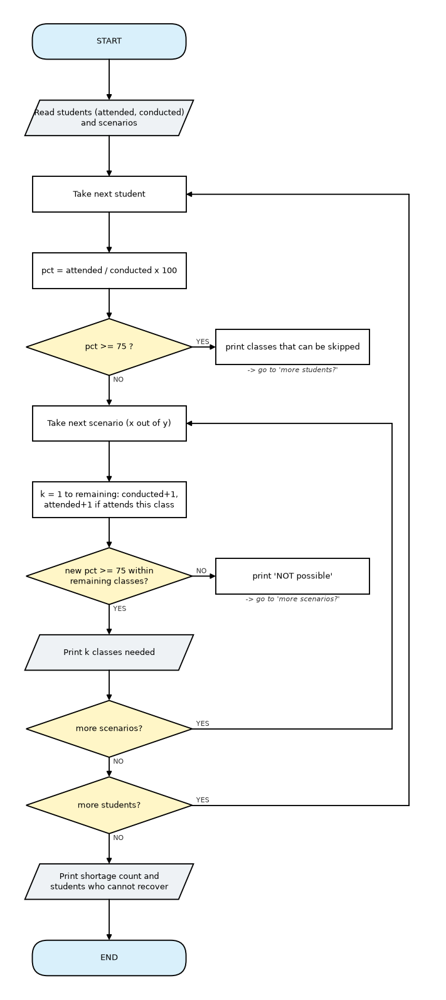
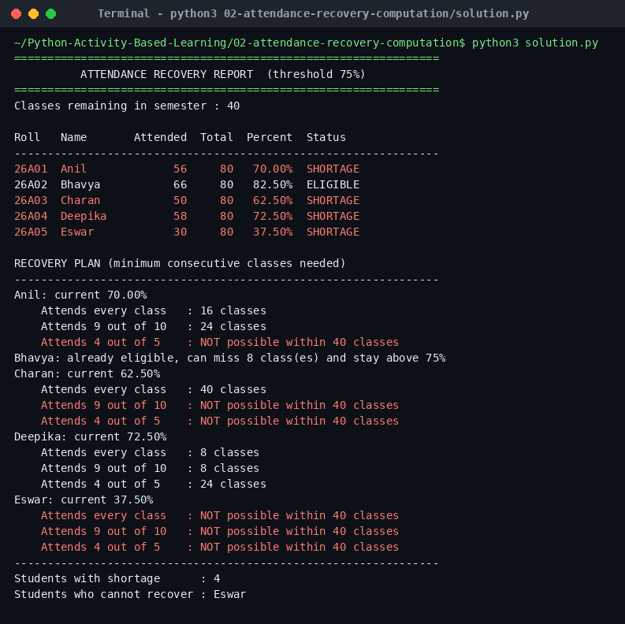

# Case Study 12 - Attendance Recovery Computation

**Name:** AKKALA LAKSHMI VENKATA SAI  
**Roll No:** 26000414

## Problem statement

Calculate current attendance percentages and determine the minimum consecutive classes required to reach an eligibility threshold under different future attendance scenarios.

## Objectives

- Calculate the attendance percentage of each student.
- Find the minimum number of future classes needed to reach 75% using a loop that simulates class by class.
- Compare three future attendance scenarios (all classes, 9 out of 10, 4 out of 5).
- Report students who cannot reach 75% in the remaining classes of the semester.

## Assumptions

- The eligibility threshold is 75% and exactly 75% is eligible.
- There are 40 classes left in the semester.
- In the 'x out of y' scenario the student attends the first x classes of every block of y classes.
- For students already above 75%, the program also shows how many classes they can miss in a row and still stay at 75% or more.
- Student records are sample data.

## Algorithm

```
1. START
2. Read students (roll, name, attended, conducted), scenarios and remaining classes
3. For each student:
   3.1 pct = attended x 100 / conducted
   3.2 If pct >= 75, find how many classes can be skipped and print it, go to next student
   3.3 Else for each scenario (x, y):
       a. k = 1
       b. conducted = conducted + 1; if (k-1) mod y < x then attended = attended + 1
       c. if new pct >= 75 then classes needed = k, stop
       d. k = k + 1, repeat from b while k <= remaining classes
       e. if not reached, print NOT possible
   3.4 If no scenario works, add student to the 'cannot recover' list
4. Print shortage count and the 'cannot recover' list
5. STOP
```

## Flowchart



## Pseudocode

```
BEGIN ATTENDANCE_RECOVERY
    FOR each (roll, name, att, total) IN STUDENTS DO
        pct <- att * 100 / total
        IF pct >= 75 THEN
            skip <- 0
            WHILE (att * 100 / (total + skip + 1)) >= 75 DO skip <- skip + 1
            PRINT "eligible, can miss", skip
            CONTINUE
        END IF
        FOR each (name, x, y) IN SCENARIOS DO
            a <- att ; c <- total ; needed <- -1
            FOR k <- 1 TO REMAINING DO
                c <- c + 1
                IF (k - 1) MOD y < x THEN a <- a + 1
                IF a * 100 / c >= 75 THEN needed <- k ; BREAK
            END FOR
            IF needed = -1 THEN PRINT "NOT possible" ELSE PRINT needed
        END FOR
    END FOR
    PRINT summary
END
```

## Python source code

File: [solution.py](solution.py)

```python
# Case Study 12 : Attendance Recovery Computation
# Name    : AKKALA LAKSHMI VENKATA SAI
# Roll No : 26000414
#
# Finds the current attendance % of each student and the minimum number of
# classes needed to reach 75% under different future attendance scenarios.

REQUIRED = 75            # eligibility threshold in percent
REMAINING_CLASSES = 40   # classes still left in the semester

# (roll no, name, classes attended, classes conducted)
STUDENTS = [
    ("26A01", "Anil", 56, 80),
    ("26A02", "Bhavya", 66, 80),
    ("26A03", "Charan", 50, 80),
    ("26A04", "Deepika", 58, 80),
    ("26A05", "Eswar", 30, 80),
]

# scenario name, attends X classes out of every Y classes
SCENARIOS = [
    ("Attends every class", 1, 1),
    ("Attends 9 out of 10", 9, 10),
    ("Attends 4 out of 5", 4, 5),
]


def percentage(attended, conducted):
    if conducted == 0:
        return 0.0
    return attended * 100 / conducted


def classes_needed(attended, conducted, x, y):
    # simulate the future classes one by one
    # returns number of classes needed, or -1 if not possible this semester
    if percentage(attended, conducted) >= REQUIRED:
        return 0
    for k in range(1, REMAINING_CLASSES + 1):
        conducted = conducted + 1
        # inside every block of y classes the student attends the first x
        if (k - 1) % y < x:
            attended = attended + 1
        if percentage(attended, conducted) >= REQUIRED:
            return k
    return -1


def classes_can_skip(attended, conducted):
    # for students already above 75%: how many classes can be missed in a row
    skip = 0
    while percentage(attended, conducted + skip + 1) >= REQUIRED:
        skip = skip + 1
    return skip


def main():
    print("=" * 64)
    print("          ATTENDANCE RECOVERY REPORT  (threshold 75%)")
    print("=" * 64)
    print(f"Classes remaining in semester : {REMAINING_CLASSES}")
    print()
    print(f"{'Roll':<7}{'Name':<10}{'Attended':>9}{'Total':>7}{'Percent':>9}  Status")
    print("-" * 64)
    for roll, name, att, total in STUDENTS:
        pct = percentage(att, total)
        if pct >= REQUIRED:
            status = "ELIGIBLE"
        else:
            status = "SHORTAGE"
        print(f"{roll:<7}{name:<10}{att:>9}{total:>7}{pct:>8.2f}%  {status}")

    print()
    print("RECOVERY PLAN (minimum consecutive classes needed)")
    print("-" * 64)
    shortage_count = 0
    cannot_recover = []
    for roll, name, att, total in STUDENTS:
        pct = percentage(att, total)
        if pct >= REQUIRED:
            can_skip = classes_can_skip(att, total)
            print(f"{name}: already eligible, can miss {can_skip} class(es) and stay above 75%")
            continue
        shortage_count = shortage_count + 1
        print(f"{name}: current {pct:.2f}%")
        possible_any = False
        for scen_name, x, y in SCENARIOS:
            need = classes_needed(att, total, x, y)
            if need == -1:
                print(f"    {scen_name:<22}: NOT possible within {REMAINING_CLASSES} classes")
            else:
                possible_any = True
                print(f"    {scen_name:<22}: {need} classes")
        if not possible_any:
            cannot_recover.append(name)

    print("-" * 64)
    print(f"Students with shortage      : {shortage_count}")
    if len(cannot_recover) == 0:
        print("Students who cannot recover : none")
    else:
        print("Students who cannot recover :", ", ".join(cannot_recover))


if __name__ == "__main__":
    main()
```

## Test cases

| TC | Input / what is checked | Expected | Result |
|----|-------------------------|----------|--------|
| 1 | percentage(52, 80) | 65.0 | Pass |
| 2 | percentage(0, 0) - no classes | 0.0 | Pass |
| 3 | already eligible student (66/80) | 0 classes | Pass |
| 4 | Deepika 58/80, attends every class | 8 | Pass |
| 5 | Anil 56/80, attends 9 out of 10 | 24 | Pass |
| 6 | Charan 50/80 - needs all 40 remaining | 40 | Pass |
| 7 | Eswar 30/80 - cannot recover | -1 | Pass |
| 8 | 60/80 is exactly 75% | 0 | Pass |
| 9 | classes_can_skip(66, 80) / (60, 80) | 8 / 0 | Pass |

The test cases are written in [test_cases.py](test_cases.py) (10 checks in total). Output of `python3 test_cases.py`:

```
PASS : 52/80 percentage
PASS : 0 classes conducted
PASS : eligible student needs 0
PASS : Deepika every class
PASS : Anil 9 out of 10
PASS : Charan needs all 40
PASS : Eswar cannot recover
PASS : 60/80 is exactly 75
PASS : Bhavya can skip 8
PASS : exactly 75% can skip 0
----------------------------------------
Passed : 10  Failed : 0
```

## Output screenshot



Full text output: [output.txt](output.txt)

## Conclusion

Simulating the future classes one by one made it easy to handle all scenarios with the same loop. The output shows that attending 4 out of 5 classes is not enough for most students, and that Charan has to attend every one of the remaining 40 classes to just reach 75%. Eswar cannot become eligible this semester in any scenario.
