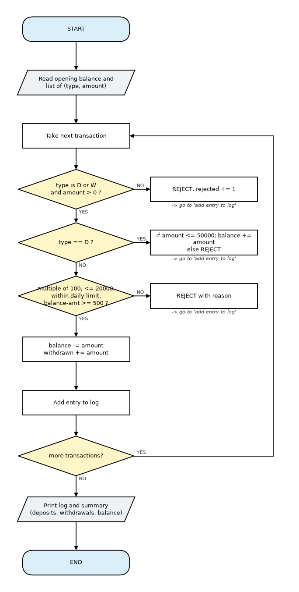
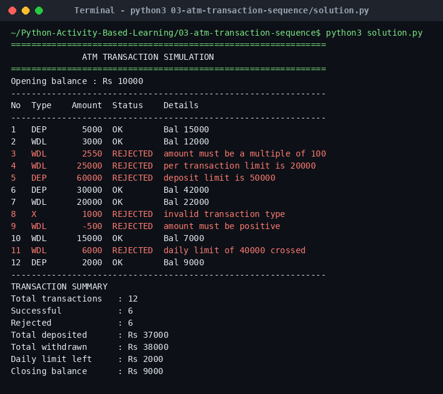

# Case Study 13 - ATM Transaction Sequence Simulation

**Name:** AKKALA LAKSHMI VENKATA SAI  
**Roll No:** 26000414

## Problem statement

Process a sequence of deposits and withdrawals, maintain a simulated balance, enforce withdrawal limits, reject invalid transactions, and produce a transaction summary.

## Objectives

- Process a list of (type, amount) transactions in order using a loop.
- Check each transaction against the rules using if-elif-else and give the reason for every rejection.
- Keep track of balance, total deposited, total withdrawn and rejected count.
- Print a transaction log and a summary.

## Assumptions

- Opening balance is Rs 10000 and the balance must not go below Rs 500.
- Only 'D' (deposit) and 'W' (withdrawal) are valid types, and the amount must be positive.
- Maximum deposit per transaction is Rs 50000.
- Withdrawals must be a multiple of 100, at most Rs 20000 at a time and at most Rs 40000 in the day.
- All transactions happen on the same day. Rejected transactions do not change the balance.

## Algorithm

```
1. START
2. balance = 10000, deposited = withdrawn = rejected = 0
3. For each (type, amount) in the transaction list:
   3.1 If type is not D or W -> reject (invalid type)
   3.2 Else if amount <= 0 -> reject
   3.3 Else if type is D:
         if amount > 50000 -> reject, else balance += amount
   3.4 Else (W):
         if amount mod 100 != 0 -> reject
         else if amount > 20000 -> reject
         else if withdrawn + amount > 40000 -> reject
         else if balance - amount < 500 -> reject
         else balance -= amount, withdrawn += amount
   3.5 Add the result to the log
4. Print the log and the summary
5. STOP
```

## Flowchart



## Pseudocode

```
BEGIN ATM_SIMULATION
    balance <- 10000 ; withdrawn <- 0 ; deposited <- 0 ; rejected <- 0
    FOR each (type, amount) IN TRANSACTIONS DO
        IF type NOT IN (D, W) THEN reason <- "invalid type"
        ELSE IF amount <= 0 THEN reason <- "amount must be positive"
        ELSE IF type = D AND amount > 50000 THEN reason <- "deposit limit"
        ELSE IF type = W AND amount MOD 100 != 0 THEN reason <- "multiple of 100"
        ELSE IF type = W AND amount > 20000 THEN reason <- "per transaction limit"
        ELSE IF type = W AND withdrawn + amount > 40000 THEN reason <- "daily limit"
        ELSE IF type = W AND balance - amount < 500 THEN reason <- "insufficient balance"
        ELSE reason <- ""
        IF reason = "" THEN
            update balance and totals ; log OK
        ELSE
            rejected <- rejected + 1 ; log REJECTED with reason
        END IF
    END FOR
    PRINT log and summary
END
```

## Python source code

File: [solution.py](solution.py)

```python
# Case Study 13 : ATM Transaction Sequence Simulation
# Name    : AKKALA LAKSHMI VENKATA SAI
# Roll No : 26000414
#
# Processes a list of deposits and withdrawals on one account, checks every
# transaction against the limits and prints a summary at the end.

OPENING_BALANCE = 10000
MIN_BALANCE = 500             # balance should not go below this
MAX_WITHDRAW_ONCE = 20000     # per transaction withdrawal limit
DAILY_WITHDRAW_LIMIT = 40000  # total withdrawal limit for the day
MAX_DEPOSIT_ONCE = 50000      # per transaction deposit limit

# (type, amount)   D = deposit, W = withdrawal
TRANSACTIONS = [
    ("D", 5000),
    ("W", 3000),
    ("W", 2550),
    ("W", 25000),
    ("D", 60000),
    ("D", 30000),
    ("W", 20000),
    ("X", 1000),
    ("W", -500),
    ("W", 15000),
    ("W", 6000),
    ("D", 2000),
]


def check_transaction(t_type, amount, balance, withdrawn_today):
    # returns (True, "") if valid, otherwise (False, reason)
    if t_type != "D" and t_type != "W":
        return False, "invalid transaction type"
    if amount <= 0:
        return False, "amount must be positive"
    if t_type == "D":
        if amount > MAX_DEPOSIT_ONCE:
            return False, "deposit limit is 50000"
        return True, ""
    # withdrawal checks
    if amount % 100 != 0:
        return False, "amount must be a multiple of 100"
    if amount > MAX_WITHDRAW_ONCE:
        return False, "per transaction limit is 20000"
    if withdrawn_today + amount > DAILY_WITHDRAW_LIMIT:
        return False, "daily limit of 40000 crossed"
    if balance - amount < MIN_BALANCE:
        return False, "insufficient balance (min 500)"
    return True, ""


def run(transactions):
    balance = OPENING_BALANCE
    withdrawn = 0
    deposited = 0
    log = []          # list of (no, type, amount, status, balance/reason)
    rejected = 0
    no = 1
    for t_type, amount in transactions:
        ok, reason = check_transaction(t_type, amount, balance, withdrawn)
        if ok:
            if t_type == "D":
                balance = balance + amount
                deposited = deposited + amount
            else:
                balance = balance - amount
                withdrawn = withdrawn + amount
            log.append((no, t_type, amount, "OK", "Bal " + str(balance)))
        else:
            rejected = rejected + 1
            log.append((no, t_type, amount, "REJECTED", reason))
        no = no + 1
    return balance, deposited, withdrawn, rejected, log


def main():
    balance, dep, wd, rejected, log = run(TRANSACTIONS)
    print("=" * 62)
    print("              ATM TRANSACTION SIMULATION")
    print("=" * 62)
    print(f"Opening balance : Rs {OPENING_BALANCE}")
    print("-" * 62)
    print(f"{'No':<4}{'Type':<6}{'Amount':>8}  {'Status':<10}Details")
    print("-" * 62)
    for no, t_type, amount, status, info in log:
        if t_type == "D":
            name = "DEP"
        elif t_type == "W":
            name = "WDL"
        else:
            name = t_type
        print(f"{no:<4}{name:<6}{amount:>8}  {status:<10}{info}")
    print("-" * 62)
    print("TRANSACTION SUMMARY")
    print(f"Total transactions   : {len(TRANSACTIONS)}")
    print(f"Successful           : {len(TRANSACTIONS) - rejected}")
    print(f"Rejected             : {rejected}")
    print(f"Total deposited      : Rs {dep}")
    print(f"Total withdrawn      : Rs {wd}")
    print(f"Daily limit left     : Rs {DAILY_WITHDRAW_LIMIT - wd}")
    print(f"Closing balance      : Rs {balance}")


if __name__ == "__main__":
    main()
```

## Test cases

| TC | Input / what is checked | Expected | Result |
|----|-------------------------|----------|--------|
| 1 | valid deposit of 5000 | accepted | Pass |
| 2 | deposit of 60000 | rejected | Pass |
| 3 | type 'X' | invalid transaction type | Pass |
| 4 | amount -500 / 0 | rejected | Pass |
| 5 | withdraw 2550 | must be a multiple of 100 | Pass |
| 6 | withdraw 25000 | rejected (limit 20000) | Pass |
| 7 | 6000 after 35000 already withdrawn | daily limit crossed | Pass |
| 8 | withdraw 9600 / 9500 from 10000 | rejected / accepted (500 left) | Pass |
| 9 | full sample run | balance 9000, deposited 37000, withdrawn 38000, 6 rejected | Pass |
| 10 | empty transaction list | balance stays 10000 | Pass |

The test cases are written in [test_cases.py](test_cases.py) (15 checks in total). Output of `python3 test_cases.py`:

```
PASS : valid deposit
PASS : deposit above 50000
PASS : invalid type X
PASS : negative amount
PASS : zero amount
PASS : 2550 not multiple of 100
PASS : withdraw 25000
PASS : daily limit crossed
PASS : min balance 500
PASS : exactly 500 left is ok
PASS : closing balance
PASS : total deposited
PASS : total withdrawn
PASS : rejected count
PASS : no transactions
----------------------------------------
Passed : 15  Failed : 0
```

## Output screenshot



Full text output: [output.txt](output.txt)

## Conclusion

All 12 sample transactions were processed in order, and the 6 invalid ones were rejected with a clear reason. The daily limit check worked: transaction 11 was refused even though the balance was enough, because Rs 38000 had already been withdrawn that day. Keeping the checks in a separate function made it easy to test each rule on its own.
