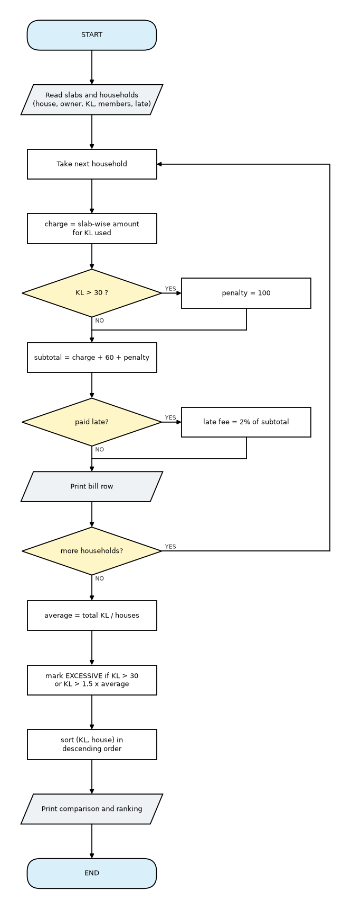
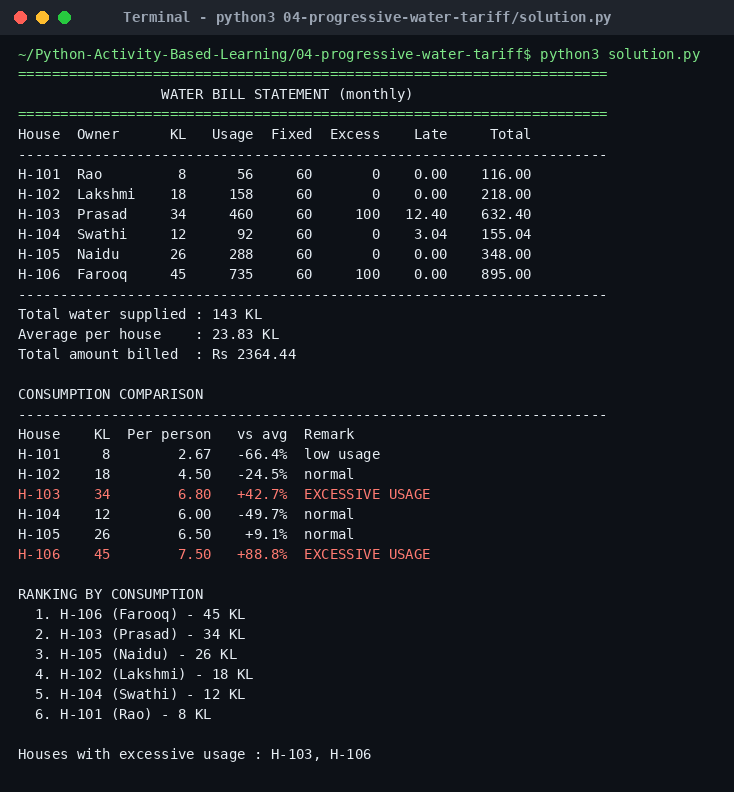

# Case Study 25 - Progressive Water Tariff Analysis

**Name:** AKKALA LAKSHMI VENKATA SAI  
**Roll No:** 26000414

## Problem statement

Calculate bills for multiple households using consumption slabs, fixed fees, and penalties; compare consumption patterns and identify excessive usage.

## Objectives

- Calculate the slab-wise water charge using a loop over the slab list.
- Add the fixed fee, the excess usage penalty and the late payment penalty using conditions.
- Compare each household with the average and find excessive usage.
- Rank households by consumption using a list of tuples.

## Assumptions

- Slabs (per kilolitre): 0-10 KL Rs 7, 11-20 KL Rs 11, 21-30 KL Rs 18, above 30 KL Rs 25.
- Fixed fee is Rs 60 for every house.
- Using more than 30 KL adds a flat penalty of Rs 100.
- Late payment adds 2% of the bill (charge + fixed fee + penalty).
- Usage is 'excessive' if it is above 30 KL or more than 1.5 times the average; 'low' if below half the average.
- Household data is sample data.

## Algorithm

```
1. START
2. Read slabs and household records (house, owner, KL, members, late)
3. For each household:
   3.1 charge = 0, lower = 0
   3.2 For each slab (upper, rate): if KL > lower then
         charge += (min(KL, upper) - lower) x rate; lower = upper
   3.3 penalty = 100 if KL > 30 else 0
   3.4 subtotal = charge + 60 + penalty
   3.5 late fee = 2% of subtotal if paid late else 0
   3.6 total = subtotal + late fee; print the bill row
4. average = total KL / number of houses
5. For each household: per person usage, % difference from average, remark
6. Make a list of (KL, house, owner), sort in descending order and print ranking
7. STOP
```

## Flowchart



## Pseudocode

```
BEGIN WATER_BILLING
    FOR each (house, owner, kl, members, late) IN HOUSEHOLDS DO
        charge <- 0 ; lower <- 0
        FOR each (upper, rate) IN SLABS DO
            IF kl > lower THEN charge <- charge + (MIN(kl, upper) - lower) * rate
            lower <- upper
        END FOR
        IF kl > 30 THEN penalty <- 100 ELSE penalty <- 0
        subtotal <- charge + 60 + penalty
        IF late THEN late_fee <- subtotal * 0.02 ELSE late_fee <- 0
        PRINT house, charge, penalty, late_fee, subtotal + late_fee
    END FOR
    average <- SUM(kl) / COUNT
    FOR each household DO
        IF kl > 30 OR kl > 1.5 * average THEN PRINT "EXCESSIVE"
        ELSE IF kl < 0.5 * average THEN PRINT "low usage"
        ELSE PRINT "normal"
    END FOR
    SORT (kl, house) in descending order and PRINT ranking
END
```

## Python source code

File: [solution.py](solution.py)

```python
# Case Study 25 : Progressive Water Tariff Analysis
# Name    : AKKALA LAKSHMI VENKATA SAI
# Roll No : 26000414
#
# Calculates the monthly water bill of several households using slabs,
# a fixed fee and penalties, then compares their usage.

# slabs in kilolitres (KL): (upper limit, rate per KL)
SLABS = [(10, 7), (20, 11), (30, 18), (10 ** 6, 25)]
FIXED_FEE = 60
EXCESS_LIMIT = 30          # usage above 30 KL gets a penalty
EXCESS_PENALTY = 100       # flat penalty for excess usage
LATE_RATE = 0.02           # 2% late payment penalty

# (house no, owner, KL used this month, family members, paid late?)
HOUSEHOLDS = [
    ("H-101", "Rao", 8, 3, False),
    ("H-102", "Lakshmi", 18, 4, False),
    ("H-103", "Prasad", 34, 5, True),
    ("H-104", "Swathi", 12, 2, True),
    ("H-105", "Naidu", 26, 4, False),
    ("H-106", "Farooq", 45, 6, False),
]


def water_charge(kl):
    charge = 0
    lower = 0
    for upper, rate in SLABS:
        if kl > lower:
            used_in_slab = min(kl, upper) - lower
            charge = charge + used_in_slab * rate
        lower = upper
    return charge


def calculate_bill(kl, late):
    usage = water_charge(kl)
    penalty = 0
    if kl > EXCESS_LIMIT:
        penalty = penalty + EXCESS_PENALTY
    subtotal = usage + FIXED_FEE + penalty
    late_fee = 0
    if late:
        late_fee = round(subtotal * LATE_RATE, 2)
    total = subtotal + late_fee
    return usage, penalty, late_fee, total


def main():
    print("=" * 70)
    print("                 WATER BILL STATEMENT (monthly)")
    print("=" * 70)
    print(f"{'House':<7}{'Owner':<9}{'KL':>4}{'Usage':>8}{'Fixed':>7}"
          f"{'Excess':>8}{'Late':>8}{'Total':>10}")
    print("-" * 70)

    total_kl = 0
    total_amount = 0
    for house, owner, kl, members, late in HOUSEHOLDS:
        usage, penalty, late_fee, total = calculate_bill(kl, late)
        total_kl = total_kl + kl
        total_amount = total_amount + total
        print(f"{house:<7}{owner:<9}{kl:>4}{usage:>8}{FIXED_FEE:>7}"
              f"{penalty:>8}{late_fee:>8.2f}{total:>10.2f}")
    print("-" * 70)

    average = total_kl / len(HOUSEHOLDS)
    print(f"Total water supplied : {total_kl} KL")
    print(f"Average per house    : {average:.2f} KL")
    print(f"Total amount billed  : Rs {total_amount:.2f}")

    # comparison of usage
    print()
    print("CONSUMPTION COMPARISON")
    print("-" * 70)
    print(f"{'House':<7}{'KL':>4}{'Per person':>12}{'vs avg':>9}  Remark")
    excessive = []
    for house, owner, kl, members, late in HOUSEHOLDS:
        per_person = kl / members
        diff = (kl - average) * 100 / average
        remark = "normal"
        if kl > EXCESS_LIMIT or kl > 1.5 * average:
            remark = "EXCESSIVE USAGE"
            excessive.append(house)
        elif kl < 0.5 * average:
            remark = "low usage"
        print(f"{house:<7}{kl:>4}{per_person:>12.2f}{diff:>+8.1f}%  {remark}")

    # ranking from highest to lowest consumption
    ranking = []
    for house, owner, kl, members, late in HOUSEHOLDS:
        ranking.append((kl, house, owner))
    ranking.sort(reverse=True)

    print()
    print("RANKING BY CONSUMPTION")
    rank = 1
    for kl, house, owner in ranking:
        print(f"  {rank}. {house} ({owner}) - {kl} KL")
        rank = rank + 1
    print()
    print("Houses with excessive usage :", ", ".join(excessive))


if __name__ == "__main__":
    main()
```

## Test cases

| TC | Input / what is checked | Expected | Result |
|----|-------------------------|----------|--------|
| 1 | water_charge(8) - first slab | 56 | Pass |
| 2 | water_charge(10) - slab boundary | 70 | Pass |
| 3 | water_charge(18) - two slabs | 158 | Pass |
| 4 | water_charge(26) - three slabs | 288 | Pass |
| 5 | water_charge(45) - all four slabs | 735 | Pass |
| 6 | water_charge(0) | 0 | Pass |
| 7 | 30 KL / 34 KL excess penalty | 0 / 100 | Pass |
| 8 | late fee for 12 KL | 3.04 | Pass |
| 9 | total bill H-103 / H-101 | 632.40 / 116.00 | Pass |

The test cases are written in [test_cases.py](test_cases.py) (11 checks in total). Output of `python3 test_cases.py`:

```
PASS : 8 KL charge
PASS : 10 KL charge
PASS : 18 KL charge
PASS : 26 KL charge
PASS : 45 KL charge
PASS : 0 KL charge
PASS : 30 KL no excess penalty
PASS : 34 KL excess penalty
PASS : late fee for H-104
PASS : total bill H-103
PASS : total bill H-101
----------------------------------------
Passed : 11  Failed : 0
```

## Output screenshot



Full text output: [output.txt](output.txt)

## Conclusion

The slab loop charges each part of the consumption at its own rate, so a house using 45 KL pays much more per KL than a house using 8 KL. H-103 and H-106 were flagged for excessive usage, and the late fee was added only for the two houses that paid late. Sorting a list of (KL, house) tuples gave the ranking without any extra code.
