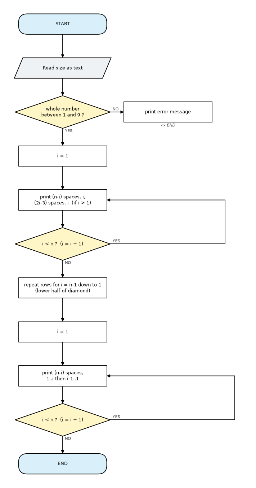
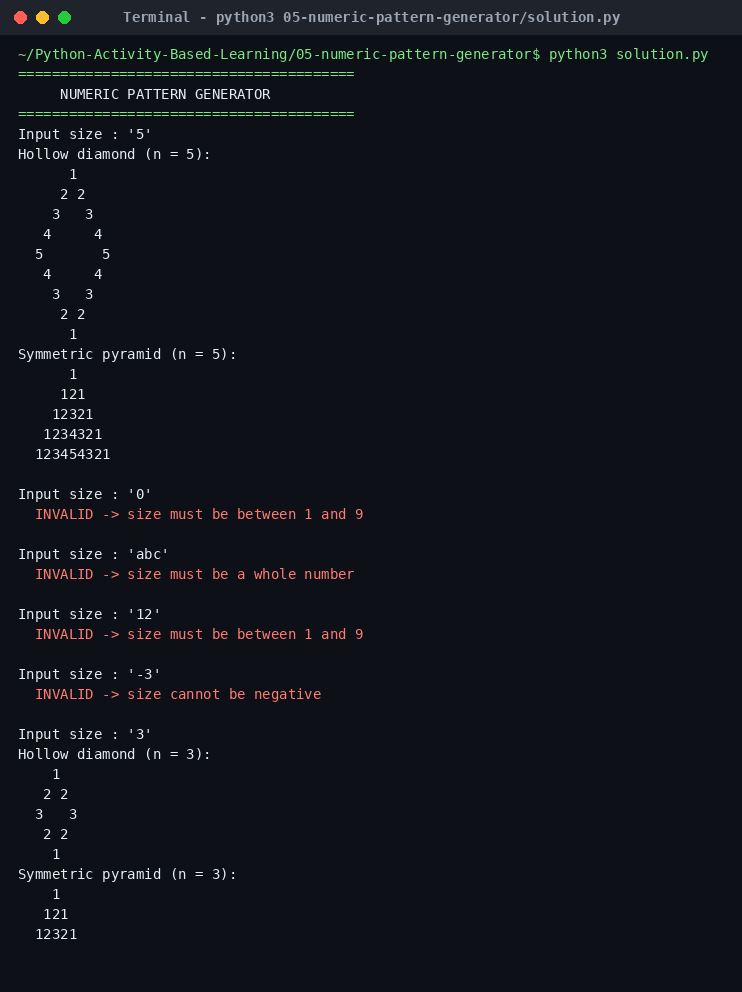

# Case Study 27 - Advanced Numeric Pattern Generator

**Name:** AKKALA LAKSHMI VENKATA SAI  
**Roll No:** 26000414

## Problem statement

Produce a hollow diamond or symmetric numerical pattern based on user-specified dimensions, with validation for invalid dimensions and carefully aligned output.

## Objectives

- Validate the size entered by the user using string methods (strip, isdigit).
- Generate a hollow number diamond using loops and string repetition for spaces.
- Generate a symmetric number pyramid (1, 121, 12321 ...) using nested loops.
- Keep the output properly aligned.

## Assumptions

- The size must be a whole number from 1 to 9. Sizes above 9 are rejected because two digit numbers would break the alignment.
- Empty input, negative numbers, decimals and letters are rejected with a message.
- When run normally the program uses a list of sample inputs (valid and invalid). Running 'python3 solution.py ask' asks the user for the size.

## Algorithm

```
1. START
2. Read size as text
3. Remove spaces. If empty, negative, not a number, or not in 1..9 -> print error and STOP
4. n = int(size)
5. Hollow diamond, top half: for i = 1 to n
     line = (n - i) spaces + i
     if i > 1: line = line + (2i - 3) spaces + i
     print line
6. Bottom half: same steps for i = n-1 down to 1
7. Pyramid: for i = 1 to n
     line = (n - i) spaces
     for j = 1 to i: add j
     for j = i-1 down to 1: add j
     print line
8. STOP
```

## Flowchart



## Pseudocode

```
BEGIN PATTERN_GENERATOR
    READ text
    text <- STRIP(text)
    IF text = "" THEN PRINT "empty" ; STOP
    IF text is not all digits THEN PRINT "invalid" ; STOP
    n <- INTEGER(text)
    IF n < 1 OR n > 9 THEN PRINT "size must be between 1 and 9" ; STOP
    FOR i <- 1 TO n DO
        line <- SPACES(n - i) + i
        IF i > 1 THEN line <- line + SPACES(2*i - 3) + i
        PRINT line
    END FOR
    FOR i <- n - 1 DOWNTO 1 DO
        (same as above)
    END FOR
    FOR i <- 1 TO n DO
        line <- SPACES(n - i)
        FOR j <- 1 TO i DO line <- line + j
        FOR j <- i - 1 DOWNTO 1 DO line <- line + j
        PRINT line
    END FOR
END
```

## Python source code

File: [solution.py](solution.py)

```python
# Case Study 27 : Advanced Numeric Pattern Generator
# Name    : AKKALA LAKSHMI VENKATA SAI
# Roll No : 26000414
#
# Prints a hollow number diamond and a symmetric number pyramid for the
# size given by the user. Invalid sizes are rejected with a message.
#
# Run normally  : python3 solution.py          (uses the sample sizes)
# Own input     : python3 solution.py ask      (asks for the size)

import sys

MIN_SIZE = 1
MAX_SIZE = 9      # above 9 the numbers become 2 digits and alignment breaks


def validate_size(text):
    # returns (True, size, "") or (False, 0, error message)
    text = text.strip()
    if text == "":
        return False, 0, "size cannot be empty"
    if text[0] == "-" and text[1:].isdigit():
        return False, 0, "size cannot be negative"
    if not text.isdigit():
        return False, 0, "size must be a whole number"
    n = int(text)
    if n < MIN_SIZE or n > MAX_SIZE:
        return False, 0, "size must be between 1 and 9"
    return True, n, ""


def hollow_diamond(n):
    # row i shows the number i only at the two edges
    lines = []
    for i in range(1, n + 1):
        line = " " * (n - i) + str(i)
        if i > 1:
            line = line + " " * (2 * i - 3) + str(i)
        lines.append(line)
    for i in range(n - 1, 0, -1):
        line = " " * (n - i) + str(i)
        if i > 1:
            line = line + " " * (2 * i - 3) + str(i)
        lines.append(line)
    return lines


def number_pyramid(n):
    # 1, 121, 12321, ... centred
    lines = []
    for i in range(1, n + 1):
        line = " " * (n - i)
        for j in range(1, i + 1):
            line = line + str(j)
        for j in range(i - 1, 0, -1):
            line = line + str(j)
        lines.append(line)
    return lines


def show_patterns(text):
    print(f"Input size : '{text}'")
    ok, n, msg = validate_size(text)
    if not ok:
        print("  INVALID ->", msg)
        print()
        return
    print(f"Hollow diamond (n = {n}):")
    for line in hollow_diamond(n):
        print("  " + line)
    print(f"Symmetric pyramid (n = {n}):")
    for line in number_pyramid(n):
        print("  " + line)
    print()


def main():
    print("=" * 40)
    print("     NUMERIC PATTERN GENERATOR")
    print("=" * 40)
    if len(sys.argv) > 1 and sys.argv[1] == "ask":
        size = input("Enter size (1-9): ")
        show_patterns(size)
    else:
        sample_inputs = ["5", "0", "abc", "12", "-3", "3"]
        for s in sample_inputs:
            show_patterns(s)


if __name__ == "__main__":
    main()
```

## Test cases

| TC | Input / what is checked | Expected | Result |
|----|-------------------------|----------|--------|
| 1 | validate '5' / ' 4 ' | valid, 5 / valid, 4 | Pass |
| 2 | validate '0' / '12' | invalid (range) | Pass |
| 3 | validate 'abc' | size must be a whole number | Pass |
| 4 | validate '-3' | size cannot be negative | Pass |
| 5 | validate '' / '2.5' | invalid | Pass |
| 6 | diamond n=5 line count | 9 lines | Pass |
| 7 | diamond n=3 / n=1 | exact lines match / ['1'] | Pass |
| 8 | pyramid n=3 | ['  1', ' 121', '12321'] | Pass |
| 9 | pyramid n=9 last row | 12345678987654321 | Pass |

The test cases are written in [test_cases.py](test_cases.py) (13 checks in total). Output of `python3 test_cases.py`:

```
PASS : size 5 valid
PASS : size with spaces
PASS : size 0
PASS : size 12
PASS : size abc
PASS : size -3
PASS : empty size
PASS : decimal 2.5
PASS : diamond lines for n=5
PASS : diamond n=3
PASS : diamond n=1
PASS : pyramid n=3
PASS : pyramid n=9 last row
----------------------------------------
Passed : 13  Failed : 0
```

## Output screenshot



Full text output: [output.txt](output.txt)

## Conclusion

The spacing formulas (n - i spaces before and 2i - 3 spaces inside) keep the diamond symmetric for every valid size. All the wrong inputs in the sample list (0, abc, 12, -3) were rejected with a proper message instead of crashing the program. Returning the pattern as a list of lines made it simple to test the exact shape.
