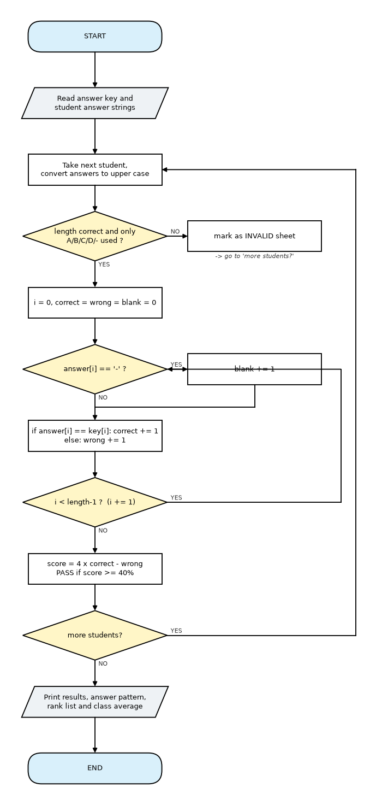
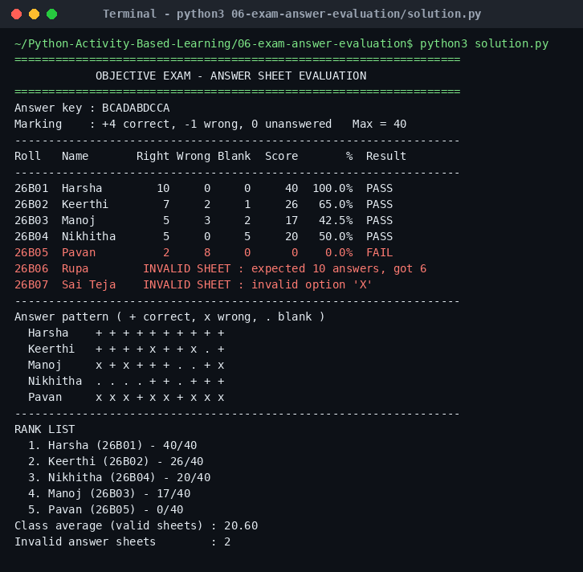

# Case Study 31 - String-Based Examination Answer Evaluation

**Name:** AKKALA LAKSHMI VENKATA SAI  
**Roll No:** 26000414

## Problem statement

Compare answer strings against an answer key, calculate correct, incorrect, and unanswered responses, apply negative marking, and produce student-wise results.

## Objectives

- Store each answer sheet as a string and compare it with the key using indexing.
- Count correct, wrong and unanswered questions and apply negative marking.
- Validate answer strings (length and allowed characters).
- Produce student-wise results, an answer pattern and a rank list.

## Assumptions

- There are 10 questions with options A, B, C, D. '-' means not answered.
- Correct answer +4, wrong answer -1, unanswered 0. Maximum marks = 40.
- Pass mark is 40% of the maximum.
- Small letters are converted to capital letters before checking.
- A sheet with the wrong length or any other character is marked invalid and not evaluated.

## Algorithm

```
1. START
2. Read answer key and student records (roll, name, answers)
3. For each student:
   3.1 answers = answers in upper case
   3.2 If length != key length or any character not in 'ABCD-' -> INVALID, next student
   3.3 correct = wrong = blank = 0
   3.4 For i = 0 to length-1:
         if answers[i] == '-' -> blank += 1
         else if answers[i] == key[i] -> correct += 1
         else wrong += 1
   3.5 score = 4 x correct - 1 x wrong; percent = score x 100 / 40
   3.6 PASS if percent >= 40 else FAIL; print result
4. Print the answer pattern (+ x .) for each valid sheet
5. Sort (score, roll, name) in descending order, print rank list and class average
6. STOP
```

## Flowchart



## Pseudocode

```
BEGIN ANSWER_EVALUATION
    FOR each (roll, name, ans) IN STUDENTS DO
        ans <- UPPER(STRIP(ans))
        IF LENGTH(ans) != LENGTH(KEY) THEN PRINT "INVALID" ; CONTINUE
        IF any ch IN ans NOT IN "ABCD-" THEN PRINT "INVALID" ; CONTINUE
        correct <- 0 ; wrong <- 0 ; blank <- 0
        FOR i <- 0 TO LENGTH(KEY) - 1 DO
            IF ans[i] = "-" THEN blank <- blank + 1
            ELSE IF ans[i] = KEY[i] THEN correct <- correct + 1
            ELSE wrong <- wrong + 1
        END FOR
        score <- correct * 4 - wrong
        IF score * 100 / 40 >= 40 THEN result <- "PASS" ELSE result <- "FAIL"
        APPEND (score, roll, name) TO results
        PRINT roll, name, correct, wrong, blank, score, result
    END FOR
    SORT results DESCENDING ; PRINT rank list and average
END
```

## Python source code

File: [solution.py](solution.py)

```python
# Case Study 31 : String-Based Examination Answer Evaluation
# Name    : AKKALA LAKSHMI VENKATA SAI
# Roll No : 26000414
#
# Each student's answers are stored as one string. The string is compared
# with the answer key character by character.
#   correct    -> +4
#   wrong      -> -1   (negative marking)
#   '-'        -> unanswered, 0

ANSWER_KEY = "BCADABDCCA"
CORRECT_MARKS = 4
WRONG_MARKS = -1
PASS_PERCENT = 40
VALID_OPTIONS = "ABCD-"

# (roll no, name, answer string)
STUDENTS = [
    ("26B01", "Harsha", "BCADABDCCA"),
    ("26B02", "Keerthi", "BCADCBDA-A"),
    ("26B03", "Manoj", "ACBDAB--CD"),
    ("26B04", "Nikhitha", "----AB-CCA"),
    ("26B05", "Pavan", "DDDDDDDDDD"),
    ("26B06", "Rupa", "BCADAB"),
    ("26B07", "Sai Teja", "bcadabdcXa"),
]


def validate_answers(answers):
    # returns "" if okay otherwise the problem
    if len(answers) != len(ANSWER_KEY):
        return "expected " + str(len(ANSWER_KEY)) + " answers, got " + str(len(answers))
    for ch in answers:
        if ch not in VALID_OPTIONS:
            return "invalid option '" + ch + "'"
    return ""


def evaluate(answers):
    correct = 0
    wrong = 0
    unanswered = 0
    for i in range(len(ANSWER_KEY)):
        if answers[i] == "-":
            unanswered = unanswered + 1
        elif answers[i] == ANSWER_KEY[i]:
            correct = correct + 1
        else:
            wrong = wrong + 1
    score = correct * CORRECT_MARKS + wrong * WRONG_MARKS
    return correct, wrong, unanswered, score


def main():
    max_marks = len(ANSWER_KEY) * CORRECT_MARKS
    print("=" * 66)
    print("            OBJECTIVE EXAM - ANSWER SHEET EVALUATION")
    print("=" * 66)
    print("Answer key :", ANSWER_KEY)
    print(f"Marking    : +{CORRECT_MARKS} correct, {WRONG_MARKS} wrong, 0 unanswered"
          f"   Max = {max_marks}")
    print("-" * 66)
    print(f"{'Roll':<7}{'Name':<10}{'Right':>6}{'Wrong':>6}{'Blank':>6}"
          f"{'Score':>7}{'%':>8}  Result")
    print("-" * 66)

    results = []     # (score, roll, name) for valid sheets
    invalid = []
    for roll, name, answers in STUDENTS:
        answers = answers.strip().upper()   # small letters are accepted
        problem = validate_answers(answers)
        if problem != "":
            invalid.append((roll, name, problem))
            print(f"{roll:<7}{name:<10}  INVALID SHEET : {problem}")
            continue
        c, w, u, score = evaluate(answers)
        pct = score * 100 / max_marks
        if pct >= PASS_PERCENT:
            result = "PASS"
        else:
            result = "FAIL"
        results.append((score, roll, name))
        print(f"{roll:<7}{name:<10}{c:>6}{w:>6}{u:>6}{score:>7}{pct:>7.1f}%  {result}")
    print("-" * 66)

    # question wise mark of the answers (pattern line), only for valid sheets
    print("Answer pattern ( + correct, x wrong, . blank )")
    for roll, name, answers in STUDENTS:
        answers = answers.strip().upper()
        if validate_answers(answers) != "":
            continue
        line = ""
        for i in range(len(ANSWER_KEY)):
            if answers[i] == "-":
                line = line + ". "
            elif answers[i] == ANSWER_KEY[i]:
                line = line + "+ "
            else:
                line = line + "x "
        print(f"  {name:<10}{line}")

    results.sort(reverse=True)
    print("-" * 66)
    print("RANK LIST")
    rank = 1
    for score, roll, name in results:
        print(f"  {rank}. {name} ({roll}) - {score}/{max_marks}")
        rank = rank + 1
    total = 0
    for score, roll, name in results:
        total = total + score
    print(f"Class average (valid sheets) : {total / len(results):.2f}")
    print(f"Invalid answer sheets        : {len(invalid)}")


if __name__ == "__main__":
    main()
```

## Test cases

| TC | Input / what is checked | Expected | Result |
|----|-------------------------|----------|--------|
| 1 | all correct | (10, 0, 0, 40) | Pass |
| 2 | all blank | (0, 0, 10, 0) | Pass |
| 3 | Keerthi 'BCADCBDA-A' | (7, 2, 1, 26) | Pass |
| 4 | Pavan (2 right, 8 wrong) | 0 | Pass |
| 5 | all 10 wrong | -10 | Pass |
| 6 | valid sheet with blanks | no error | Pass |
| 7 | sheet with 6 answers | expected 10 answers, got 6 | Pass |
| 8 | sheet with 'X' | invalid option 'X' | Pass |
| 9 | lowercase sheet after upper() | 40 | Pass |

The test cases are written in [test_cases.py](test_cases.py) (10 checks in total). Output of `python3 test_cases.py`:

```
PASS : all correct
PASS : all blank
PASS : Keerthi
PASS : Pavan score
PASS : all wrong gives -10
PASS : valid sheet
PASS : short sheet
PASS : invalid letter
PASS : small letters invalid before upper()
PASS : lowercase converted
----------------------------------------
Passed : 10  Failed : 0
```

## Output screenshot



Full text output: [output.txt](output.txt)

## Conclusion

Comparing the two strings position by position was enough to evaluate every sheet. Negative marking had a real effect: Pavan got 2 answers right but scored 0 because of 8 wrong answers. Two incorrect sheets (too short, and with an invalid letter) were caught before evaluation, so they did not give wrong scores.
