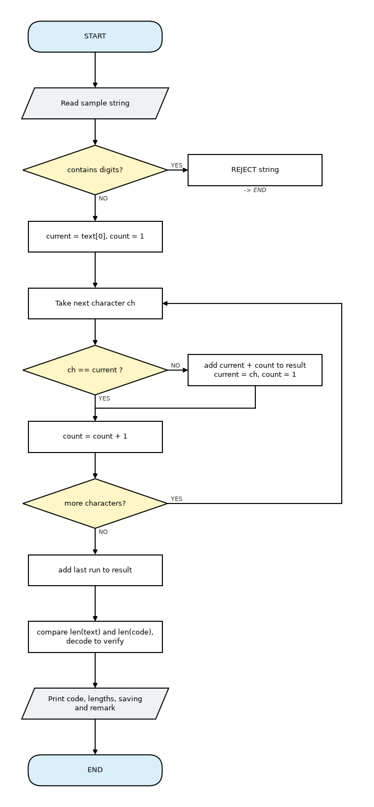
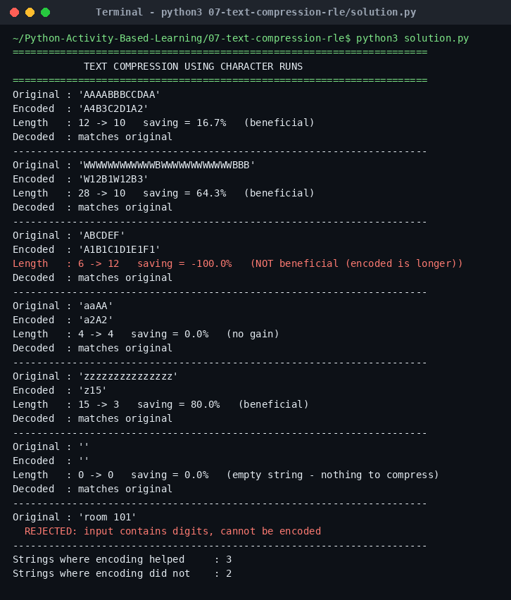

# Case Study 35 - Text Compression Using Character Runs

**Name:** AKKALA LAKSHMI VENKATA SAI  
**Roll No:** 26000414

## Problem statement

Encode a string by grouping consecutive repeated characters and compare original and encoded lengths, including cases where encoding is not beneficial.

## Objectives

- Encode a string using run length encoding (character followed by its count).
- Decode the result back to check that no information is lost.
- Compare the original and encoded lengths and calculate the saving percentage.
- Show cases where encoding does not help (no repeated characters).

## Assumptions

- Every run is written as the character followed by the count, even when the count is 1 (e.g. 'D1').
- Encoding is case sensitive, so 'a' and 'A' are different characters. Spaces are also characters.
- Input strings must not contain digits, because the counts are digits. Such strings are rejected.
- An empty string gives an empty result.

## Algorithm

```
1. START
2. For each sample string:
   2.1 If it contains a digit -> reject and go to next string
   2.2 If empty -> code = ''
   2.3 current = first char, count = 1, result = ''
   2.4 For each next character ch:
         if ch == current -> count += 1
         else -> result += current + count; current = ch; count = 1
   2.5 result += current + count (last run)
   2.6 saving = (len(text) - len(code)) x 100 / len(text)
   2.7 remark = beneficial / no gain / not beneficial
   2.8 decode the code and check it equals the original
   2.9 print everything
3. Print how many strings benefited
4. STOP
```

## Flowchart



## Pseudocode

```
BEGIN RLE
    FOR each text IN SAMPLES DO
        IF text contains a digit THEN PRINT "REJECTED" ; CONTINUE
        code <- "" ; current <- text[0] ; count <- 1
        FOR i <- 1 TO LENGTH(text) - 1 DO
            IF text[i] = current THEN count <- count + 1
            ELSE
                code <- code + current + STR(count)
                current <- text[i] ; count <- 1
            END IF
        END FOR
        code <- code + current + STR(count)
        IF LENGTH(code) < LENGTH(text) THEN remark <- "beneficial"
        ELSE IF LENGTH(code) = LENGTH(text) THEN remark <- "no gain"
        ELSE remark <- "NOT beneficial"
        decoded <- DECODE(code)
        PRINT code, lengths, remark, decoded = text
    END FOR
END
```

## Python source code

File: [solution.py](solution.py)

```python
# Case Study 35 : Text Compression Using Character Runs
# Name    : AKKALA LAKSHMI VENKATA SAI
# Roll No : 26000414
#
# Run length encoding: consecutive repeated characters are replaced by the
# character followed by the count.  "AAABB" -> "A3B2"
# The encoded length is compared with the original length to see if the
# compression actually helped.

SAMPLES = [
    "AAAABBBCCDAA",
    "WWWWWWWWWWWWBWWWWWWWWWWWWBBB",
    "ABCDEF",
    "aaAA",
    "zzzzzzzzzzzzzzz",
    "",
    "room 101",
]


def is_valid(text):
    # digits are not allowed because the counts are also digits
    for ch in text:
        if ch.isdigit():
            return False
    return True


def encode(text):
    if text == "":
        return ""
    result = ""
    current = text[0]
    count = 1
    for i in range(1, len(text)):
        if text[i] == current:
            count = count + 1
        else:
            result = result + current + str(count)
            current = text[i]
            count = 1
    result = result + current + str(count)   # last run
    return result


def decode(code):
    result = ""
    i = 0
    while i < len(code):
        ch = code[i]
        i = i + 1
        number = ""
        while i < len(code) and code[i].isdigit():
            number = number + code[i]
            i = i + 1
        result = result + ch * int(number)
    return result


def compare(text, code):
    # returns (saving percent, remark)
    if len(text) == 0:
        return 0.0, "empty string - nothing to compress"
    saving = (len(text) - len(code)) * 100 / len(text)
    if len(code) < len(text):
        remark = "beneficial"
    elif len(code) == len(text):
        remark = "no gain"
    else:
        remark = "NOT beneficial (encoded is longer)"
    return saving, remark


def main():
    print("=" * 70)
    print("            TEXT COMPRESSION USING CHARACTER RUNS")
    print("=" * 70)
    beneficial = 0
    not_beneficial = 0
    for text in SAMPLES:
        print(f"Original : '{text}'")
        if not is_valid(text):
            print("  REJECTED: input contains digits, cannot be encoded")
            print("-" * 70)
            continue
        code = encode(text)
        saving, remark = compare(text, code)
        back = decode(code)
        print(f"Encoded  : '{code}'")
        print(f"Length   : {len(text)} -> {len(code)}   saving = {saving:.1f}%   ({remark})")
        if back == text:
            print("Decoded  : matches original")
        else:
            print("Decoded  : MISMATCH")
        if len(text) > 0:
            if len(code) < len(text):
                beneficial = beneficial + 1
            else:
                not_beneficial = not_beneficial + 1
        print("-" * 70)
    print(f"Strings where encoding helped     : {beneficial}")
    print(f"Strings where encoding did not    : {not_beneficial}")


if __name__ == "__main__":
    main()
```

## Test cases

| TC | Input / what is checked | Expected | Result |
|----|-------------------------|----------|--------|
| 1 | encode 'AAAABBBCCDAA' | A4B3C2D1A2 | Pass |
| 2 | encode 15 'z' | z15 (two digit count) | Pass |
| 3 | encode 'ABCDEF' | A1B1C1D1E1F1 | Pass |
| 4 | encode 'aaAA' | a2A2 (case sensitive) | Pass |
| 5 | encode '' / 'x' | '' / 'x1' | Pass |
| 6 | encode 'a   b' | a1 3b1 (spaces counted) | Pass |
| 7 | decode 'W12B1' and decode(encode(...)) | original string | Pass |
| 8 | compare remarks | beneficial / no gain / NOT beneficial | Pass |
| 9 | is_valid('room 101') | False | Pass |

The test cases are written in [test_cases.py](test_cases.py) (14 checks in total). Output of `python3 test_cases.py`:

```
PASS : encode AAAABBBCCDAA
PASS : encode 15 z
PASS : encode ABCDEF
PASS : encode aaAA
PASS : encode empty
PASS : encode single char
PASS : encode with spaces
PASS : decode W12B1
PASS : decode back
PASS : beneficial
PASS : no gain
PASS : not beneficial
PASS : digits rejected
PASS : letters accepted
----------------------------------------
Passed : 14  Failed : 0
```

## Output screenshot



Full text output: [output.txt](output.txt)

## Conclusion

Run length encoding saved a lot of space for strings with long runs (64.3% and 80%), but for 'ABCDEF' the encoded string was twice as long. So this method is only useful when the data has many repeated characters. Decoding every result back to the original string confirmed that the encoding is correct, including the two digit counts.
