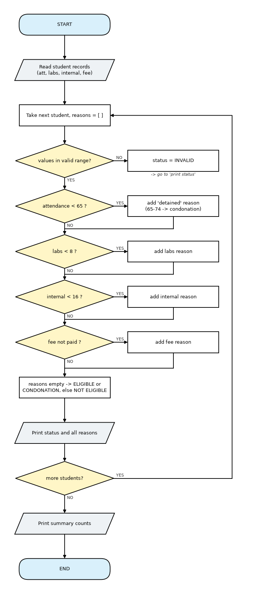
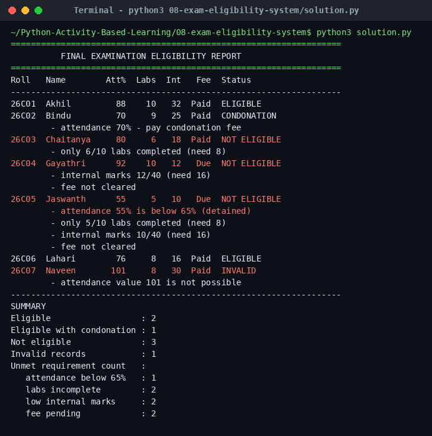

# Case Study 39 - Multi-Stage Examination Eligibility System

**Name:** AKKALA LAKSHMI VENKATA SAI  
**Roll No:** 26000414

## Problem statement

Determine eligibility for a final examination using attendance, laboratory completion, internal assessment, and fee-clearance conditions, reporting every unmet requirement.

## Objectives

- Check four separate conditions for every student using independent if statements.
- Report all unmet requirements, not just the first one.
- Handle the condonation case (65% to 74% attendance) and invalid records.
- Print a summary with counts of each type of problem.

## Assumptions

- Attendance of 75% or more is required. 65% to 74% is allowed only after paying a condonation fee. Below 65% is detained.
- At least 8 out of 10 lab experiments must be completed.
- Internal marks must be at least 16 out of 40.
- Fee must be fully paid.
- Attendance above 100, or labs/internal marks outside their range, makes the record invalid.
- Student data is sample data.

## Algorithm

```
1. START
2. Read student records (roll, name, attendance, labs, internal, fee paid)
3. For each student:
   3.1 If attendance not in 0..100 or labs/internal out of range -> INVALID
   3.2 reasons = empty list
   3.3 If attendance < 65 -> add 'detained' reason
       else if attendance < 75 -> condonation = True
   3.4 If labs < 8 -> add labs reason
   3.5 If internal < 16 -> add internal reason
   3.6 If fee not paid -> add fee reason
   3.7 If reasons not empty -> NOT ELIGIBLE
       else if condonation -> CONDONATION
       else -> ELIGIBLE
   3.8 Print status and every reason, update counters
4. Print summary
5. STOP
```

## Flowchart



## Pseudocode

```
BEGIN ELIGIBILITY
    FOR each (roll, name, att, labs, internal, fee) IN STUDENTS DO
        IF att < 0 OR att > 100 OR labs NOT IN 0..10 OR internal NOT IN 0..40 THEN
            status <- "INVALID"
        ELSE
            reasons <- [] ; condonation <- FALSE
            IF att < 65 THEN APPEND "detained" TO reasons
            ELSE IF att < 75 THEN condonation <- TRUE
            IF labs < 8 THEN APPEND "labs" TO reasons
            IF internal < 16 THEN APPEND "internal" TO reasons
            IF NOT fee THEN APPEND "fee" TO reasons
            IF LENGTH(reasons) > 0 THEN status <- "NOT ELIGIBLE"
            ELSE IF condonation THEN status <- "CONDONATION"
            ELSE status <- "ELIGIBLE"
        END IF
        PRINT status and reasons ; update counts
    END FOR
    PRINT summary
END
```

## Python source code

File: [solution.py](solution.py)

```python
# Case Study 39 : Multi-Stage Examination Eligibility System
# Name    : AKKALA LAKSHMI VENKATA SAI
# Roll No : 26000414
#
# A student can write the final exam only if ALL four conditions are met:
#   1. attendance >= 75%   (65% to 74% allowed after paying condonation fee)
#   2. at least 8 out of 10 lab experiments completed
#   3. internal marks >= 16 out of 40
#   4. fee is fully paid
# Every condition that is not met is reported, not just the first one.

MIN_ATTENDANCE = 75
CONDONATION_ATTENDANCE = 65
TOTAL_LABS = 10
MIN_LABS = 8
MAX_INTERNAL = 40
MIN_INTERNAL = 16

# (roll, name, attendance %, labs done, internal marks, fee paid?)
STUDENTS = [
    ("26C01", "Akhil", 88, 10, 32, True),
    ("26C02", "Bindu", 70, 9, 25, True),
    ("26C03", "Chaitanya", 80, 6, 18, True),
    ("26C04", "Gayathri", 92, 10, 12, False),
    ("26C05", "Jaswanth", 55, 5, 10, False),
    ("26C06", "Lahari", 76, 8, 16, True),
    ("26C07", "Naveen", 101, 8, 30, True),
]


def check_eligibility(student):
    # returns (status, list of reasons)
    roll, name, att, labs, internal, fee_paid = student
    reasons = []

    # input checks first
    if att < 0 or att > 100:
        return "INVALID", ["attendance value " + str(att) + " is not possible"]
    if labs < 0 or labs > TOTAL_LABS or internal < 0 or internal > MAX_INTERNAL:
        return "INVALID", ["labs or internal marks out of range"]

    condonation = False
    if att < CONDONATION_ATTENDANCE:
        reasons.append("attendance " + str(att) + "% is below 65% (detained)")
    elif att < MIN_ATTENDANCE:
        condonation = True

    if labs < MIN_LABS:
        reasons.append("only " + str(labs) + "/10 labs completed (need 8)")
    if internal < MIN_INTERNAL:
        reasons.append("internal marks " + str(internal) + "/40 (need 16)")
    if not fee_paid:
        reasons.append("fee not cleared")

    if len(reasons) > 0:
        return "NOT ELIGIBLE", reasons
    if condonation:
        return "CONDONATION", ["attendance " + str(att) + "% - pay condonation fee"]
    return "ELIGIBLE", []


def main():
    print("=" * 66)
    print("          FINAL EXAMINATION ELIGIBILITY REPORT")
    print("=" * 66)
    print(f"{'Roll':<7}{'Name':<11}{'Att%':>5}{'Labs':>6}{'Int':>5}{'Fee':>6}  Status")
    print("-" * 66)

    eligible = 0
    condonation = 0
    not_eligible = 0
    invalid = 0
    # count of each reason type
    att_fail = 0
    lab_fail = 0
    int_fail = 0
    fee_fail = 0

    for student in STUDENTS:
        roll, name, att, labs, internal, fee_paid = student
        status, reasons = check_eligibility(student)
        fee_text = "Paid" if fee_paid else "Due"
        print(f"{roll:<7}{name:<11}{att:>5}{labs:>6}{internal:>5}{fee_text:>6}  {status}")
        for r in reasons:
            print("        -", r)
            if "detained" in r:
                att_fail = att_fail + 1
            elif "labs" in r:
                lab_fail = lab_fail + 1
            elif "internal" in r:
                int_fail = int_fail + 1
            elif "fee not" in r:
                fee_fail = fee_fail + 1

        if status == "ELIGIBLE":
            eligible = eligible + 1
        elif status == "CONDONATION":
            condonation = condonation + 1
        elif status == "NOT ELIGIBLE":
            not_eligible = not_eligible + 1
        else:
            invalid = invalid + 1

    print("-" * 66)
    print("SUMMARY")
    print(f"Eligible                  : {eligible}")
    print(f"Eligible with condonation : {condonation}")
    print(f"Not eligible              : {not_eligible}")
    print(f"Invalid records           : {invalid}")
    print("Unmet requirement count   :")
    print(f"   attendance below 65%   : {att_fail}")
    print(f"   labs incomplete        : {lab_fail}")
    print(f"   low internal marks     : {int_fail}")
    print(f"   fee pending            : {fee_fail}")


if __name__ == "__main__":
    main()
```

## Test cases

| TC | Input / what is checked | Expected | Result |
|----|-------------------------|----------|--------|
| 1 | Akhil - all conditions met | ELIGIBLE | Pass |
| 2 | exact boundary 75% / 8 labs / 16 marks | ELIGIBLE | Pass |
| 3 | attendance 70% / 65% | CONDONATION | Pass |
| 4 | attendance 64% | NOT ELIGIBLE | Pass |
| 5 | only 7 labs | NOT ELIGIBLE | Pass |
| 6 | Jaswanth - fails everything | 4 reasons | Pass |
| 7 | Gayathri - internal and fee | 2 reasons | Pass |
| 8 | 70% attendance but fee due | NOT ELIGIBLE | Pass |
| 9 | attendance 101 / internal 45 | INVALID | Pass |

The test cases are written in [test_cases.py](test_cases.py) (11 checks in total). Output of `python3 test_cases.py`:

```
PASS : Akhil eligible
PASS : boundary 75/8/16
PASS : 70% condonation
PASS : 65% condonation
PASS : 64% not eligible
PASS : labs 7
PASS : Jaswanth 4 reasons
PASS : Gayathri 2 reasons
PASS : 70% with fee due
PASS : attendance 101
PASS : internal 45
----------------------------------------
Passed : 11  Failed : 0
```

## Output screenshot



Full text output: [output.txt](output.txt)

## Conclusion

Using separate if statements (instead of one if-elif chain) made the program report every problem of a student. For example, Jaswanth got all four reasons in one report. The boundary values (exactly 75%, 8 labs, 16 marks) were treated as eligible, and the impossible attendance of 101% was caught as an invalid record.
