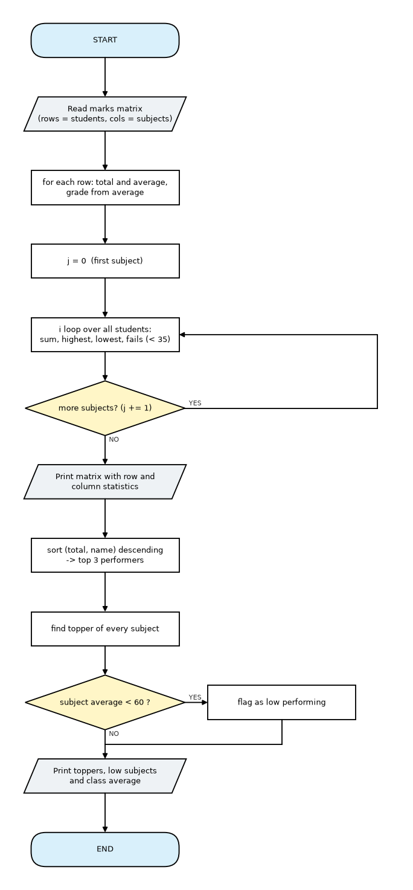
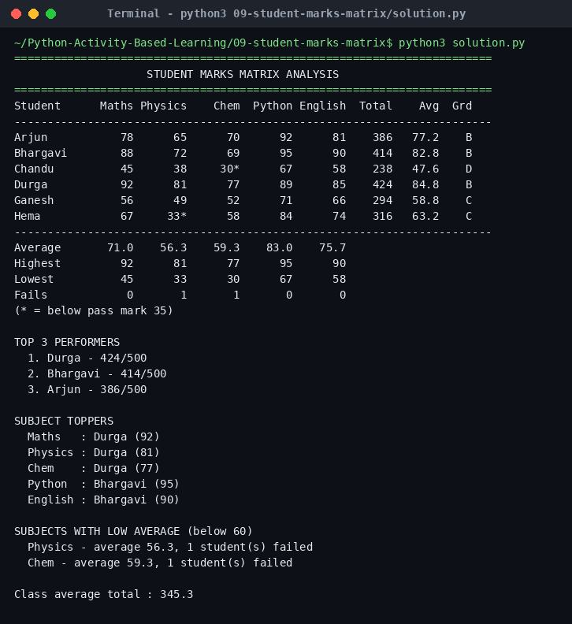

# Case Study 42 - Student Marks Matrix Analysis

**Name:** AKKALA LAKSHMI VENKATA SAI  
**Roll No:** 26000414

## Problem statement

Analyse a matrix of student marks across subjects, calculate row-wise and column-wise statistics, identify top performers, and detect subjects with low average performance.

## Objectives

- Store marks of 6 students in 5 subjects as a nested list.
- Calculate row-wise total, average and grade for each student.
- Calculate column-wise average, highest, lowest and fail count for each subject using nested loops.
- Find the top 3 students, subject toppers and subjects with a low average.

## Assumptions

- Marks are out of 100 in every subject and the pass mark is 35.
- Grades: A 85+, B 70+, C 55+, D 40+, else F (based on the average).
- A subject is 'low performing' if its class average is below 60.
- If two students have the same total, the one with the alphabetically larger name comes first (normal tuple sorting).
- Marks are sample data.

## Algorithm

```
1. START
2. Read SUBJECTS, STUDENTS and the MARKS matrix
3. For each row i: total = sum of row, average = total / 5, grade from average
4. For each column j:
   4.1 total = 0, high = low = MARKS[0][j], fails = 0
   4.2 For each row i: add MARKS[i][j], update high and low,
       if MARKS[i][j] < 35 then fails += 1
   4.3 average = total / number of students
5. Print the matrix with row and column statistics (mark fails with *)
6. Make list of (total, name), sort descending, print first 3
7. For each subject find the student with the highest mark
8. Print subjects with average < 60
9. STOP
```

## Flowchart



## Pseudocode

```
BEGIN MARKS_MATRIX
    FOR i <- 0 TO rows - 1 DO
        total[i] <- SUM(MARKS[i]) ; avg[i] <- total[i] / cols
    END FOR
    FOR j <- 0 TO cols - 1 DO
        sum <- 0 ; high <- MARKS[0][j] ; low <- MARKS[0][j] ; fails <- 0
        FOR i <- 0 TO rows - 1 DO
            sum <- sum + MARKS[i][j]
            IF MARKS[i][j] > high THEN high <- MARKS[i][j]
            IF MARKS[i][j] < low THEN low <- MARKS[i][j]
            IF MARKS[i][j] < 35 THEN fails <- fails + 1
        END FOR
        col_avg[j] <- sum / rows
    END FOR
    PRINT matrix and statistics
    SORT (total, name) DESCENDING ; PRINT top 3
    FOR j DO IF col_avg[j] < 60 THEN PRINT "low performing", SUBJECTS[j]
END
```

## Python source code

File: [solution.py](solution.py)

```python
# Case Study 42 : Student Marks Matrix Analysis
# Name    : AKKALA LAKSHMI VENKATA SAI
# Roll No : 26000414
#
# Marks are stored in a nested list (matrix).
#   each row    = one student
#   each column = one subject
# Row-wise and column-wise statistics are calculated using nested loops.

SUBJECTS = ["Maths", "Physics", "Chem", "Python", "English"]
STUDENTS = ["Arjun", "Bhargavi", "Chandu", "Durga", "Ganesh", "Hema"]
PASS_MARK = 35
LOW_AVERAGE = 60

MARKS = [
    [78, 65, 70, 92, 81],
    [88, 72, 69, 95, 90],
    [45, 38, 30, 67, 58],
    [92, 81, 77, 89, 85],
    [56, 49, 52, 71, 66],
    [67, 33, 58, 84, 74],
]


def row_stats(matrix):
    # returns list of (total, average) for every student
    stats = []
    for row in matrix:
        total = 0
        for m in row:
            total = total + m
        stats.append((total, total / len(row)))
    return stats


def column_stats(matrix):
    # returns list of (average, highest, lowest, fail count) for every subject
    stats = []
    for j in range(len(matrix[0])):
        total = 0
        high = matrix[0][j]
        low = matrix[0][j]
        fails = 0
        for i in range(len(matrix)):
            m = matrix[i][j]
            total = total + m
            if m > high:
                high = m
            if m < low:
                low = m
            if m < PASS_MARK:
                fails = fails + 1
        stats.append((total / len(matrix), high, low, fails))
    return stats


def grade(avg):
    if avg >= 85:
        return "A"
    elif avg >= 70:
        return "B"
    elif avg >= 55:
        return "C"
    elif avg >= 40:
        return "D"
    else:
        return "F"


def main():
    rows = row_stats(MARKS)
    cols = column_stats(MARKS)

    print("=" * 72)
    print("                    STUDENT MARKS MATRIX ANALYSIS")
    print("=" * 72)
    header = f"{'Student':<10}"
    for s in SUBJECTS:
        header = header + f"{s:>8}"
    header = header + f"{'Total':>7}{'Avg':>7}{'Grd':>5}"
    print(header)
    print("-" * 72)
    for i in range(len(MARKS)):
        line = f"{STUDENTS[i]:<10}"
        for m in MARKS[i]:
            if m < PASS_MARK:
                line = line + f"{str(m) + '*':>8}"
            else:
                line = line + f"{m:>8}"
        total, avg = rows[i]
        line = line + f"{total:>7}{avg:>7.1f}{grade(avg):>5}"
        print(line)
    print("-" * 72)
    labels = ["Average", "Highest", "Lowest", "Fails"]
    for k in range(4):
        line = f"{labels[k]:<10}"
        for j in range(len(SUBJECTS)):
            value = cols[j][k]
            if k == 0:
                line = line + f"{value:>8.1f}"
            else:
                line = line + f"{value:>8}"
        print(line)
    print("(* = below pass mark 35)")

    # top performers - sort (total, name) tuples
    ranking = []
    for i in range(len(STUDENTS)):
        ranking.append((rows[i][0], STUDENTS[i]))
    ranking.sort(reverse=True)
    print()
    print("TOP 3 PERFORMERS")
    for pos in range(3):
        total, name = ranking[pos]
        print(f"  {pos + 1}. {name} - {total}/{len(SUBJECTS) * 100}")

    # subject toppers
    print()
    print("SUBJECT TOPPERS")
    for j in range(len(SUBJECTS)):
        best = 0
        for i in range(len(MARKS)):
            if MARKS[i][j] > MARKS[best][j]:
                best = i
        print(f"  {SUBJECTS[j]:<8}: {STUDENTS[best]} ({MARKS[best][j]})")

    # low performing subjects
    print()
    print(f"SUBJECTS WITH LOW AVERAGE (below {LOW_AVERAGE})")
    found = False
    for j in range(len(SUBJECTS)):
        avg, high, low, fails = cols[j]
        if avg < LOW_AVERAGE:
            found = True
            print(f"  {SUBJECTS[j]} - average {avg:.1f}, {fails} student(s) failed")
    if not found:
        print("  none")

    # class average
    class_total = 0
    for total, avg in rows:
        class_total = class_total + total
    print()
    print(f"Class average total : {class_total / len(STUDENTS):.1f}")


if __name__ == "__main__":
    main()
```

## Test cases

| TC | Input / what is checked | Expected | Result |
|----|-------------------------|----------|--------|
| 1 | Arjun total / Durga total | 386 / 424 | Pass |
| 2 | Chandu average | 47.6 | Pass |
| 3 | Maths average / Python average | 71.0 / 83.0 | Pass |
| 4 | Chem highest / lowest | 77 / 30 | Pass |
| 5 | Physics fails / Maths fails | 1 / 0 | Pass |
| 6 | grade(85) / grade(77.2) / grade(39.9) | A / B / F | Pass |
| 7 | row_stats of 2x2 matrix | [(30, 15.0), (70, 35.0)] | Pass |
| 8 | column_stats of 2x2 matrix | [(20.0, 30, 10, 2), (30.0, 40, 20, 1)] | Pass |

The test cases are written in [test_cases.py](test_cases.py) (14 checks in total). Output of `python3 test_cases.py`:

```
PASS : Arjun total
PASS : Durga total
PASS : Chandu average
PASS : Maths average
PASS : Python average
PASS : Chem highest
PASS : Chem lowest
PASS : Physics fails
PASS : Maths fails
PASS : grade 85
PASS : grade 77.2
PASS : grade 39.9
PASS : 2x2 rows
PASS : 2x2 cols
----------------------------------------
Passed : 14  Failed : 0
```

## Output screenshot



Full text output: [output.txt](output.txt)

## Conclusion

The nested list made it natural to get student statistics by going along a row and subject statistics by going down a column. Durga is the class topper with 424/500, and Physics and Chemistry were found to have averages below 60, each with one failure. The extra 2x2 test matrix confirmed the row and column logic works for any size.
