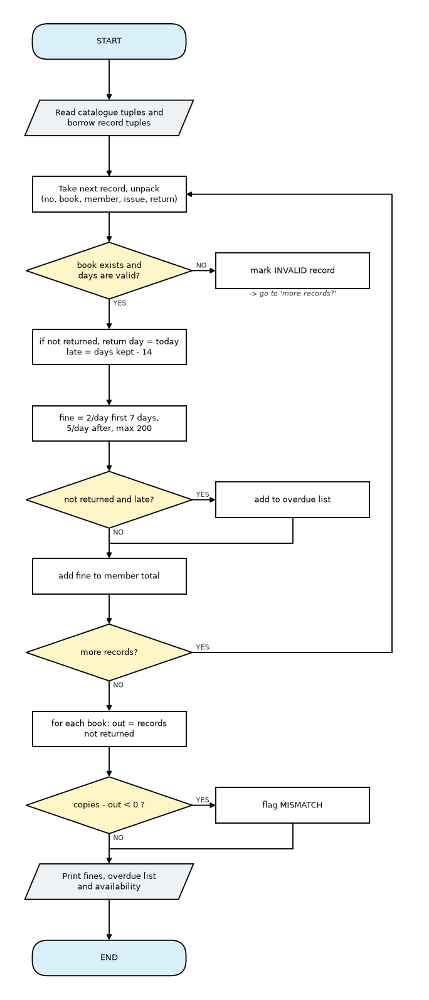
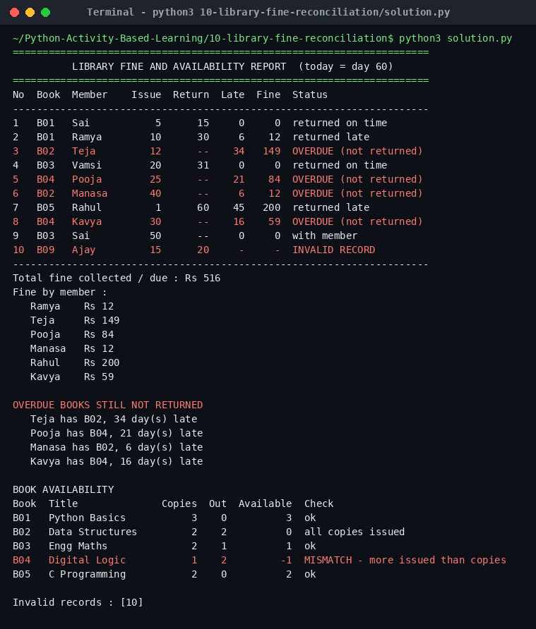

# Case Study 58 - Library Borrowing and Fine Reconciliation

**Name:** AKKALA LAKSHMI VENKATA SAI  
**Roll No:** 26000414

## Problem statement

Analyse tuples representing book identifiers, borrowing periods, and return delays; calculate fines, identify overdue records, and reconcile book availability.

## Objectives

- Store the catalogue and the borrow records as tuples and read them with tuple unpacking.
- Calculate late days and fines using a two-rate fine policy with a maximum limit.
- Find books that are overdue and still not returned.
- Reconcile availability (copies - issued) and detect mismatches and invalid records.

## Assumptions

- Days are given as day numbers of the semester. Today is day 60.
- Return day 0 means the book is not returned yet; its late days are counted up to today.
- Loan period is 14 days. Fine is Rs 2 per day for the first 7 late days and Rs 5 per day after that, maximum Rs 200 per book.
- A record is invalid if the book is not in the catalogue, or the return day is before the issue day.
- Records are sample data; record 8 is a deliberate error (2 copies of B04 issued but only 1 exists).

## Algorithm

```
1. START
2. Read catalogue tuples (book id, title, copies) and record tuples
   (no, book id, member, issue day, return day)
3. For each record (unpacked):
   3.1 If book not found or return < issue -> INVALID, next record
   3.2 If return day = 0, use today
   3.3 late = days kept - 14 (0 if not positive)
   3.4 If late <= 7: fine = late x 2
       else fine = 7 x 2 + (late - 7) x 5
       if fine > 200: fine = 200
   3.5 If not returned and late > 0 -> add to overdue list
   3.6 Add fine to the member's total and to the overall total
4. For each book: out = number of valid records not returned
   available = copies - out; if < 0 -> MISMATCH
5. Print fines, overdue list, availability and invalid records
6. STOP
```

## Flowchart



## Pseudocode

```
BEGIN LIBRARY_FINES
    FOR each (no, book, member, issue, ret) IN RECORDS DO
        IF FIND(book) = () OR (ret != 0 AND ret < issue) THEN
            APPEND no TO invalid ; CONTINUE
        IF ret = 0 THEN end_day <- TODAY ELSE end_day <- ret
        late <- MAX(0, end_day - issue - 14)
        IF late <= 7 THEN fine <- late * 2
        ELSE fine <- 14 + (late - 7) * 5
        IF fine > 200 THEN fine <- 200
        IF ret = 0 AND late > 0 THEN APPEND (member, book, late) TO overdue
        total_fine <- total_fine + fine
    END FOR
    FOR each (book, title, copies) IN CATALOGUE DO
        out <- COUNT of valid records of book with ret = 0
        available <- copies - out
        IF available < 0 THEN PRINT "MISMATCH"
    END FOR
END
```

## Python source code

File: [solution.py](solution.py)

```python
# Case Study 58 : Library Borrowing and Fine Reconciliation
# Name    : AKKALA LAKSHMI VENKATA SAI
# Roll No : 26000414
#
# Borrowing records are tuples. Days are counted as day numbers of the
# semester (day 1, day 2 ...). A return day of 0 means not yet returned.
#
# Fine rules:
#   loan period 14 days
#   Rs 2 per day for the first 7 late days
#   Rs 5 per day after that
#   maximum fine Rs 200 per book

TODAY = 60
LOAN_DAYS = 14
FIRST_RATE = 2
FIRST_DAYS = 7
LATER_RATE = 5
MAX_FINE = 200

# catalogue : (book id, title, number of copies)
CATALOGUE = (
    ("B01", "Python Basics", 3),
    ("B02", "Data Structures", 2),
    ("B03", "Engg Maths", 2),
    ("B04", "Digital Logic", 1),
    ("B05", "C Programming", 2),
)

# borrow records : (record no, book id, member, issue day, return day)
RECORDS = (
    (1, "B01", "Sai", 5, 15),
    (2, "B01", "Ramya", 10, 30),
    (3, "B02", "Teja", 12, 0),
    (4, "B03", "Vamsi", 20, 31),
    (5, "B04", "Pooja", 25, 0),
    (6, "B02", "Manasa", 40, 0),
    (7, "B05", "Rahul", 1, 60),
    (8, "B04", "Kavya", 30, 0),
    (9, "B03", "Sai", 50, 0),
    (10, "B09", "Ajay", 15, 20),
)


def late_days(issue, ret):
    # if the book is not returned, count till today
    if ret == 0:
        ret = TODAY
    days_kept = ret - issue
    if days_kept > LOAN_DAYS:
        return days_kept - LOAN_DAYS
    return 0


def fine_for(days_late):
    if days_late <= 0:
        return 0
    if days_late <= FIRST_DAYS:
        fine = days_late * FIRST_RATE
    else:
        fine = FIRST_DAYS * FIRST_RATE + (days_late - FIRST_DAYS) * LATER_RATE
    if fine > MAX_FINE:
        fine = MAX_FINE
    return fine


def find_book(book_id):
    for bid, title, copies in CATALOGUE:
        if bid == book_id:
            return (bid, title, copies)
    return ()


def main():
    print("=" * 70)
    print(f"          LIBRARY FINE AND AVAILABILITY REPORT  (today = day {TODAY})")
    print("=" * 70)
    print(f"{'No':<4}{'Book':<6}{'Member':<9}{'Issue':>6}{'Return':>8}"
          f"{'Late':>6}{'Fine':>6}  Status")
    print("-" * 70)

    total_fine = 0
    overdue_list = []
    invalid_list = []
    member_fines = []          # list of [member, fine]

    for rec_no, book_id, member, issue, ret in RECORDS:
        book = find_book(book_id)
        if book == () or (ret != 0 and ret < issue) or issue > TODAY:
            invalid_list.append(rec_no)
            print(f"{rec_no:<4}{book_id:<6}{member:<9}{issue:>6}{ret:>8}"
                  f"{'-':>6}{'-':>6}  INVALID RECORD")
            continue
        late = late_days(issue, ret)
        fine = fine_for(late)
        total_fine = total_fine + fine
        if ret == 0:
            ret_text = "--"
            if late > 0:
                status = "OVERDUE (not returned)"
                overdue_list.append((member, book_id, late))
            else:
                status = "with member"
        else:
            ret_text = str(ret)
            if late > 0:
                status = "returned late"
            else:
                status = "returned on time"
        print(f"{rec_no:<4}{book_id:<6}{member:<9}{issue:>6}{ret_text:>8}"
              f"{late:>6}{fine:>6}  {status}")

        # add fine to member total
        if fine > 0:
            found = False
            for item in member_fines:
                if item[0] == member:
                    item[1] = item[1] + fine
                    found = True
            if not found:
                member_fines.append([member, fine])

    print("-" * 70)
    print(f"Total fine collected / due : Rs {total_fine}")
    print("Fine by member :")
    for member, fine in member_fines:
        print(f"   {member:<8} Rs {fine}")

    print()
    print("OVERDUE BOOKS STILL NOT RETURNED")
    for member, book_id, late in overdue_list:
        print(f"   {member} has {book_id}, {late} day(s) late")

    # reconcile availability
    print()
    print("BOOK AVAILABILITY")
    print(f"{'Book':<6}{'Title':<18}{'Copies':>7}{'Out':>5}{'Available':>11}  Check")
    for bid, title, copies in CATALOGUE:
        out = 0
        for rec_no, book_id, member, issue, ret in RECORDS:
            if book_id == bid and ret == 0 and rec_no not in invalid_list:
                out = out + 1
        available = copies - out
        check = "ok"
        if available < 0:
            check = "MISMATCH - more issued than copies"
        elif available == 0:
            check = "all copies issued"
        print(f"{bid:<6}{title:<18}{copies:>7}{out:>5}{available:>11}  {check}")

    print()
    print("Invalid records :", invalid_list)


if __name__ == "__main__":
    main()
```

## Test cases

| TC | Input / what is checked | Expected | Result |
|----|-------------------------|----------|--------|
| 1 | returned on day 15 (issued day 5) | 0 late days | Pass |
| 2 | kept exactly 14 days | 0 late days | Pass |
| 3 | Ramya issued 10, returned 30 | 6 late days | Pass |
| 4 | Teja not returned (issued 12) | 34 late days | Pass |
| 5 | fine for 6 / 7 days | 12 / 14 | Pass |
| 6 | fine for 8 / 21 days | 19 / 84 | Pass |
| 7 | fine for 45 days / 0 days | 200 (max) / 0 | Pass |
| 8 | find_book('B04') / find_book('B09') | tuple / empty tuple | Pass |

The test cases are written in [test_cases.py](test_cases.py) (12 checks in total). Output of `python3 test_cases.py`:

```
PASS : returned on day 15
PASS : exactly 14 days
PASS : Ramya 6 days late
PASS : Teja not returned
PASS : fine 6 days
PASS : fine 7 days
PASS : fine 8 days
PASS : fine 21 days
PASS : fine capped at 200
PASS : no fine
PASS : find B04
PASS : unknown book
----------------------------------------
Passed : 12  Failed : 0
```

## Output screenshot



Full text output: [output.txt](output.txt)

## Conclusion

Tuple unpacking made the record loop easy to read. The two-rate fine policy and the Rs 200 limit both appear in the output (Rahul's fine was limited to 200). The availability check found that Digital Logic (B04) had 2 copies issued while only 1 copy exists, and the record for the unknown book B09 was marked invalid instead of being counted.
